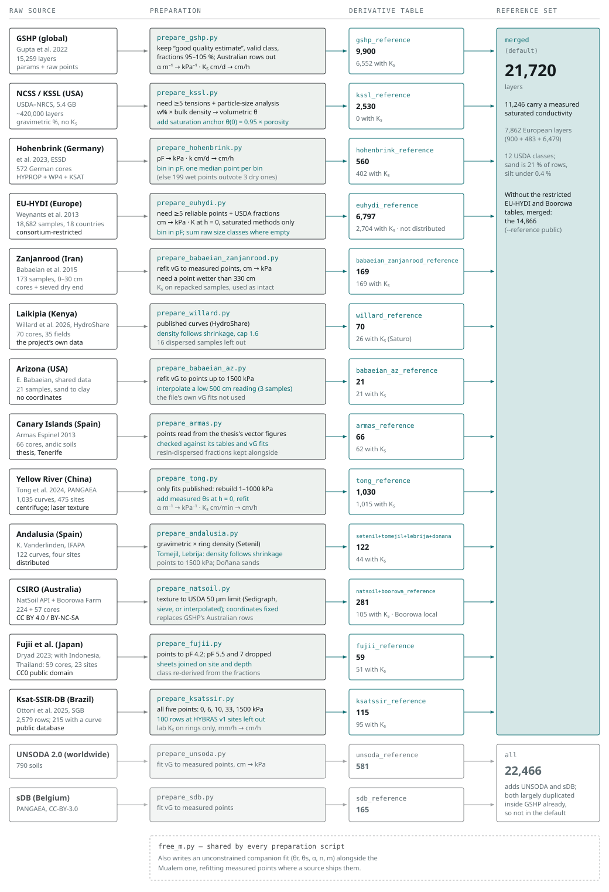
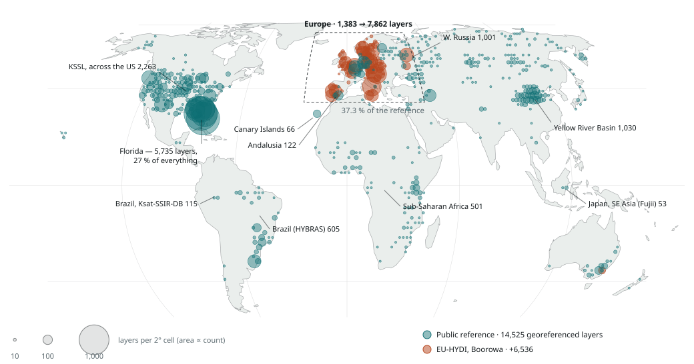
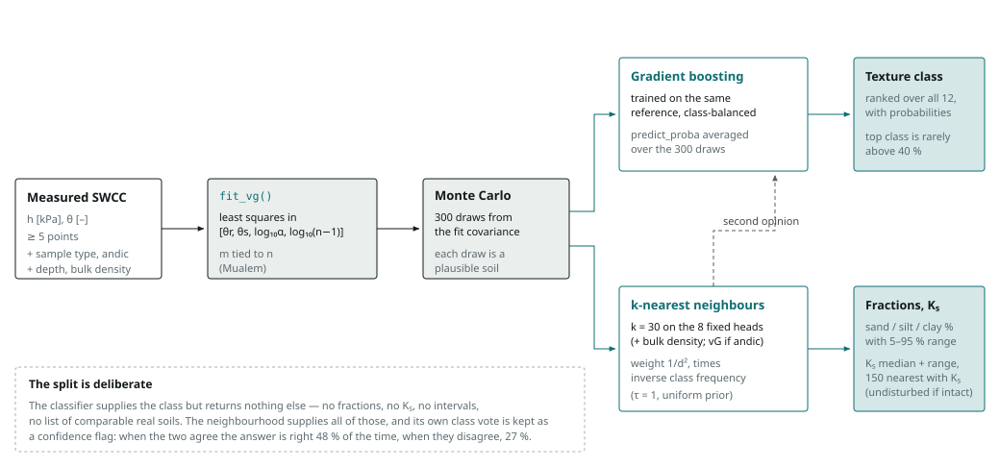
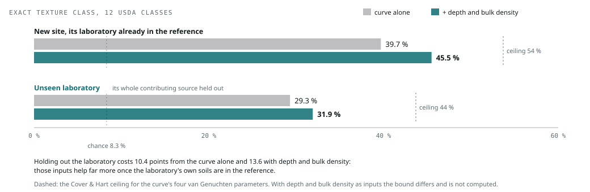

<!-- Written from figures/workflow.html by figures/make_workflow_md.py; edit the page, not this file. -->

# From measured retention curves to texture and Ks

How fifteen source databases become one reference table. How one soil water
characteristic curve becomes a texture class and a conductivity estimate. And
what each validation level proves.

## 1. Building the reference

Each source ships something different: published van Genuchten parameters, raw
retention points or gravimetric water contents. So each source gets its own
`prepare_*.py`. All of them write the same schema: one row per soil layer,
with the fitted parameters, the measured sand, silt and clay, Ks
where it exists, and the provenance.

*Figure 1.* Each source needs a different correction before its curves are
comparable. KSSL's wettest measurement is at 6 kPa, so nothing constrains
saturation, and a raw fit puts α five to sixteen times too low. An anchor at
θ(0) = 0.95 × porosity fixes it. Hohenbrink has the opposite problem: 199
HYPROP points on the wet limb against three on the dry limb. An unthinned
least-squares fit would weight the curve 98:2 away from the part that carries
texture. EU-HYDI brings the sample-level HYPRES data. But many of its
contributors shipped only two or four retention points per sample, too few to
fit a curve. So Greece and most of Spain drop out, and Poland's texture must
be summed from raw size classes. Its table is built locally from
consortium-restricted data and never distributed. Laikipia uses the published
curves (HydroShare), made volumetric with a density that follows shrinkage
(cap 1.6). The 16 samples with possibly incomplete dispersion are left out,
and the table is the project's own and distributed. The Andalusian rings (K.
Vanderlinden, IFAPA) are gravimetric. They are made volumetric with the
density of each Setenil ring and, for the Tomejil vertisol, with a density
that follows shrinkage. Their tables are distributed with K. Vanderlinden's
agreement. The Arizona, Canary Islands and Yellow River tables are public. The
Yellow River curves are published only as fits, so they are rebuilt from 1 to
1000 kPa and refitted. The Canary points are read from the vector figures of
the thesis and checked against its own tables. The two newest sources are
public too: Fujii et al. (Japan and Southeast Asia, CC0) and Ksat-SSIR-DB
(Brazil). In Ksat-SSIR-DB, 100 rows from three theses sit at HYBRAS v1 sites
that GSHP already holds, so they are left out. A checkout without the
restricted tables runs on the public 14,866.

| Column | Meaning |
|---|---|
| alpha_kpa, n, thetar, thetas | Mualem-constrained fit, *m* = 1 − 1/*n* — the four matching coordinates |
| alpha_kpa_m, n_m, …, m | Unconstrained companion fit, available but not used by default |
| sand, silt, clay, texture_class | Measured particle fractions and the USDA class they imply |
| ksat_cmh | Saturated conductivity, cm/h — missing for 48 % of rows |
| profile_id, source_db, lat, lon | Provenance, used to hold data out honestly during validation |
| depth_cm, bd, oc, porosity | Covariates: depth and bulk density are optional inputs; organic carbon and porosity were tested and not adopted |

### Where the reference actually comes from

Coverage explains why several findings in this project point the same way.
Before EU-HYDI, three quarters of the reference sat in North America, and
almost half of it came from one Florida contributor. EU-HYDI (Weynants et al.
2013), shared for this work under consortium terms, adds 6,797 European layers
from 21 laboratories in 16 countries. It takes Europe from 1,261 layers to
7,740 (7,862 with the Andalusian soils that joined later). In October 2026,
Fujii et al. and Ksat-SSIR-DB added 51 georeferenced layers in Japan, Thailand
and Indonesia and 115 in Brazil, two regions where the reference is thin.

*Figure 2.* Equal Earth projection, so circle areas compare across latitudes.
Samples are binned into 2° cells, and circle area is proportional to the
number of layers. Teal is the public reference: 14,525 of its 14,866 layers
carry coordinates. (UNSODA and sDB publish none, the 21 Arizona soils have
none, 30 of the 70 Laikipia soils, from large farms, have none, and 6 of the
Fujii horizons have none.) Orange-red is EU-HYDI (6,479 of 6,797 layers
georeferenced) and the 57 CSIRO Boorowa cores. The 122 Andalusian curves
(Setenil, Tomejil, Lebrija and Doñana), the Laikipia soils and the Fujii and
Ksat-SSIR-DB layers are part of the public reference. EU-HYDI is
consortium-restricted, and Boorowa is for non-commercial use only. Both are
part of the default reference wherever their tables have been built locally.
They are never distributed, and they appear here only as cell counts. 3 layers
south of 58°S, in Antarctica, fall outside the mapped area and are not drawn.
Land outline: Natural Earth 110 m, public domain.

| Region | Public reference | Default reference | Added |
|---|---:|---:|---:|
| North America | 9,258 | 9,258 | +0 |
| Europe | 1,383 | 7,862 | +6,479 |
| Asia | 2,421 | 2,704 | +283 |
| South America | 754 | 754 | +0 |
| Africa | 777 | 789 | +12 |
| Australasia | 239 | 296 | +57 |
| **Georeferenced** | 14,525 | 21,061 | +6,536 |

Europe goes from 9.5 % of the georeferenced reference to 37.3 %, and the
Nordic gap is largely closed. In Europe above 58°N, the reference now holds
1,333 layers, against 160 before; 199 of them are above 62°N, against 22.
EU-HYDI cannot fill the south. Greece and most of Spain contributed only two
retention points per sample (field capacity and wilting point). That is too
few to fit a curve, so Spain, Greece and the Balkans stay thin. Florida still
supplies 27 % of all georeferenced layers. The regional boxes overlap slightly
at their edges: the Asia box takes in western Russia and Ukraine, and the
Africa box takes in the far south of Spain, where the Setenil rings sit. So
the regions sum to a little more than the total. East of 90°E the Asia box
reaches 11°S, so that it counts Indonesia.

### What the European data does for accuracy

Coverage is not accuracy. The rows below are paired: the same targets,
predicted from the public reference and then with EU-HYDI added. The folds are
grouped by profile or by laboratory, so neither model ever sees the target.
There are sixty targets per class, both models, exact texture class
(`dev/verify_euhydi.py`, October 2026).

| Targets | Model | Public reference | + EU-HYDI | Change |
|---|---|---:|---:|---:|
| European soils already in the public tables | kNN | 28.5 % | 30.4 % | +1.9 pp (p=0.17) |
|  | hybrid | 29.6 % | 30.3 % | +0.7 pp (p=0.76) |
| Non-European soils | kNN | 40.6 % | 39.3 % | −1.3 pp (p=0.36) |
|  | hybrid | 31.8 % | 33.3 % | +1.5 pp (p=0.38) |
| European soil from an unseen laboratory | kNN | 29.3 % | 32.5 % | +3.2 pp (p=0.02) |
|  | hybrid | 28.3 % | 29.6 % | +1.3 pp (p=0.52) |

Six thousand European layers from twenty-one laboratories help a little for a
European soil from a laboratory the reference has never seen: +3.2 points with
the neighbour vote (p=0.02), and +1.3 with the classifier (not significant).
European soils whose laboratory is already in the public tables gain little
(+1.9 and +0.7 points, neither significant). Non-European soils do not move.
What helps most is the target's own laboratory. With it present (only the
target's profile held out), exact class rises by 5.4 points for the kNN
(p=0.0001) and 2.9 for the hybrid (p=0.10). Ks goes from
essentially unpredictable (ρ = 0.10) to modest (ρ = 0.30).

This changes how the earlier regional evidence reads. Removing Europe from the
reference cost European soils 9 points, while removing the same number of
non-European layers cost nothing. But removing Europe also removed the
target's own laboratory. So the gap that looked regional is, at least largely,
a laboratory gap: measurement protocol, not geography. This is also why more
laboratories stopped helping after the second or third.

For in-situ sensors, this points to a more useful experiment than more
external data. A sensor network is, in effect, one laboratory with one
protocol. So a modest set of cores characterised within the same network may
give more than any quantity of data from elsewhere. These results suggest this
hypothesis; they do not test it.

## 2. Predicting from one curve

The input is two columns: suction in kPa and water content. Everything
downstream comes from a four-parameter fit. The fit's own uncertainty is
carried through to the answer, not discarded: 300 draws from the fit
covariance each vote through their own neighbourhood.

*Figure 3.* Both halves see the same 300 draws, so fit uncertainty propagates
through the class probabilities and the intervals alike. Only the texture
class comes from the classifier. Switching to `--model knn` changes that one
output, and every other number stays bit-identical. The sample type is the one
required extra input; it is undisturbed by default, as for an in-situ sensor.
The classifier sees it. For an undisturbed sample, Ks comes only
from undisturbed neighbours, because the large pores that control
Ks survive only in intact soil. Disturbed samples use every soil,
because the reference holds only 45 disturbed layers with a measured
Ks. Depth and bulk density are optional. The classifier uses both,
and bulk density also joins the neighbour search, which lowers the
Ks error slightly when your source is in the reference. The andic
state of the soil (`--andic yes/no`) is optional too. The classifier uses it,
and the neighbours match on it for the class vote and the fractions. They do
not match on it for Ks: when this was tested, the only andic soils
with a measured Ks came from one source.

## 3. What the validation proves

Almost every accuracy number in pedotransfer work comes from leave-one-out on
a pooled database, and it can be optimistic. Layers from one contributing
laboratory share a measurement protocol, so a soil is easier to recognise
among the curves of its own laboratory. Holding out the other horizons of a
test soil costs little, because horizons of one profile are truly different
samples. But holding out its laboratory costs about ten points from the curve
alone, and fourteen with depth and bulk density. That is the number a new data
source should expect.

*Figure 4.* Paired on the same 1,680 test soils (150 per class, every silt)
that carry depth and bulk density, predicted as the shipped tool runs them
(`verify_holdout.py`, October 2026, on the reference before Fujii and
Ksat-SSIR-DB joined). The Cover & Hart (1967) bound brackets the Bayes error
from the nearest-neighbour error, so it does not depend on a model. About 54 %
exact class within the reference's distribution, and 44 % against an unseen
laboratory, is the hard limit for *any* method that uses the four van
Genuchten parameters alone. The gap between 29 % and that limit is what better
data can still buy. Depth and bulk density are further inputs, so the bound
does not cover them. They raise the score most where the laboratory is already
in the reference.

Each verification script tests one link in the chain. `verify_carsel_parrish`
and `verify_rosetta` test against foreign parameter sets. `verify_gshp` tests
against real soils held out of the reference, `verify_source_blocked` against
an unseen laboratory, and `verify_ceiling` sets the limit above. Every one of
them also scores conductivity, through `ksat_metrics.py`. That is how the next
point came to light.

> **Conductivity transfers less well than texture.** Predict the Hohenbrink
> cores from a reference that does *not* contain them: Ks is too low
> by 0.56 orders of magnitude (a factor of about 3.6). Only 20 % of soils are
> within a factor of two, and the interval coverage is 51 %, against a nominal
> 90 %. Texture on the same soils holds up at 33 % exact.
>
> Part of the cause is the reference population. Hohenbrink's median
> Ks is 20.9 cm/h, against 10.5 for GSHP: a factor of two. Intact
> cores measured with a KSAT device carry flow through macropores and
> aggregates. A lookup matched on the retention curve cannot fully see that
> flow.

Putting the cores' own source into the reference recovers much of the loss.
The rows below are paired: the same 560 cores, predicted first from a
reference without their source and then with it. They are held out by site, so
no core predicts itself. The last four rows show what adding those cores does
to everyone else.

| Ks for | Bias | Within 2× | Coverage | ρ |
|---|---:|---:|---:|---:|
| Hohenbrink cores, reference *without* their source | −0.56 | 20 % | 51 % | 0.32 |
| Hohenbrink cores, reference *with* their source | −0.16 | 29 % | 65 % | 0.42 |
| European soils, before adding Hohenbrink | −0.07 | 30 % | 66 % | 0.50 |
| European soils, after | +0.00 | 27 % | 69 % | 0.49 |
| Non-European soils, before | +0.00 | 49 % | 80 % | 0.79 |
| Non-European soils, after | +0.03 | 48 % | 80 % | 0.78 |

Bias is in log10 cm/h. Coverage is the share of measured values
inside the reported 5–95 % band, against a nominal 90 %. With their own source
in the reference, the bias of the cores falls from −0.56 to −0.16, and
coverage rises from 51 % to 65 %. For everyone else, the cores change
Ks very little (European coverage 66 % to 69 %, non-European soils
unchanged). So they stay in the default reference, for the soils they
represent.

Read positively, the tests support the premise of the tool and answer the
practical question directly. Conductivity is read mainly from the wet end of
the curve. A model given only suctions up to 100 cm predicts Ks
better than one given only the dry end (0.47 against 0.58 dex, p<0.001).
Texture, in contrast, is spread along the whole curve. An unseen laboratory
costs both halves about a quarter of their skill: texture keeps 72 % of its
kappa, and Ks 73 % of its rank correlation. Ks loses
more of its level, because laboratories differ systematically in measured
Ks.

Take a sensor network whose protocol the reference has never seen, with depth
and bulk density from installation. The tool reads 32 % of its soils to the
exact class and 58 % to the texture group, against 12 % and 32 % from depth
and bulk density alone. It puts the physical Ks within a factor of
10 of the measured core for 75 % of soils (52 % without the curve). Replicate
cores of one soil differ by a median factor of 3.3, so no method can do better
than about a factor of 2.3 on a single core. Once the network's own verified
sites are in the reference, in quantity, the tool reaches 44 % exact, 66 %
group and a Ks error of ×2.4. The statistics, the confidence
signals and the figures are in the README section *Is it predictive?*
(`verify_predictive.py`, `verify_network.py`).

---

Reference counts as of the merged default, 31 October 2026. Sources: GSHP
(Gupta et al. 2022), NCSS/KSSL (USDA-NRCS), Hohenbrink et al. (2023), EU-HYDI
(Weynants et al. 2013), Babaeian et al. (2015; Arizona, shared data),
Armas-Espinel (2013), Tong et al. (2024), Willard et al. (2026, HydroShare),
Vanderlinden et al. (2017, 2021), Fujii et al. (2023, Dryad), Ottoni et al.
(2025, Ksat-SSIR-DB), UNSODA 2.0, sDB (Vereecken et al. 2017). Code and data:
github.com/carpena1/py_HB_texture
