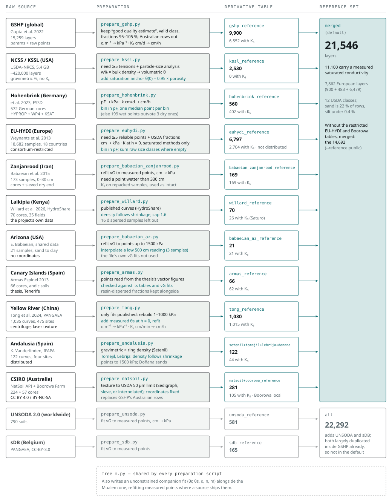
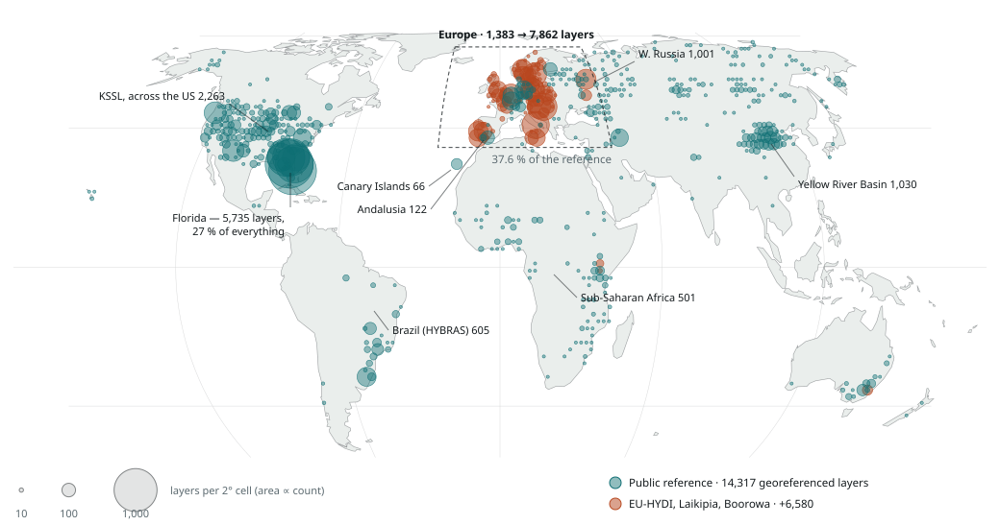
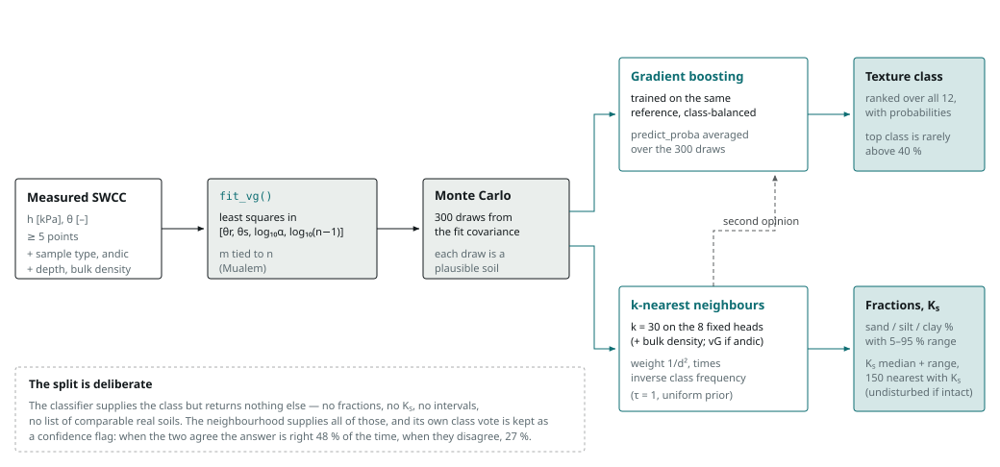
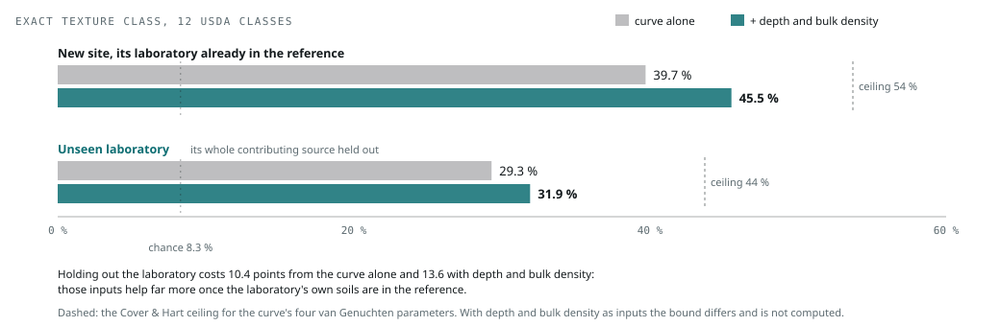

<!-- Written from figures/workflow.html by figures/make_workflow_md.py; edit the page, not this file. -->

# From measured retention curves to texture and Ks

How thirteen source databases become one reference table, how a single soil
water characteristic curve is turned into a texture class and a conductivity
estimate, and what each validation level actually proves.

## 1. Building the reference

Each source ships something different — published van Genuchten parameters,
raw retention points, gravimetric water contents — so each gets its own
`prepare_*.py`. What they share is the output schema: one row per soil layer,
carrying the fitted parameters, measured sand/silt/clay, Ks where
it exists, and provenance.

*Figure 1.* Each source needs a different correction before its curves are
comparable. KSSL's wettest measurement is 6 kPa, so nothing constrains
saturation and a raw fit puts α five to sixteen times too low — the anchor at
θ(0) = 0.95 × porosity fixes it. Hohenbrink has the opposite problem: 199
HYPROP points on the wet limb against three on the dry one, so an unthinned
least-squares fit would weight the curve 98:2 away from the part that carries
texture. EU-HYDI brings the sample-level HYPRES data, but many of its
contributors shipped only two or four retention points per sample — too few to
fit a curve — which is why Greece and most of Spain drop out, and Poland's
texture has to be summed from raw size classes. Its table is built locally
from consortium-restricted data and never distributed. Laikipia's sandbox did
not saturate its cores, so only saturation, anchored on porosity, and the
pressure plates are kept; its table is the project's own and distributed. The
Andalusian rings (K. Vanderlinden, IFAPA) are gravimetric, made volumetric
with each Setenil ring's density and, for the Tomejil vertisol, with a density
that follows shrinkage; their tables are distributed with K. Vanderlinden's
agreement. A checkout without the restricted tables runs on the public 14,692.
The Arizona, Canary Islands and Yellow River tables are public; the Yellow
River curves are published only as fits, so they are rebuilt from 1 to 1000
kPa and refitted; the Canary points are read from the thesis's vector figures
and checked against its own tables.

| Column | Meaning |
|---|---|
| alpha_kpa, n, thetar, thetas | Mualem-constrained fit, *m* = 1 − 1/*n* — the four matching coordinates |
| alpha_kpa_m, n_m, …, m | Unconstrained companion fit, available but not used by default |
| sand, silt, clay, texture_class | Measured particle fractions and the USDA class they imply |
| ksat_cmh | Saturated conductivity, cm/h — missing for 48 % of rows |
| profile_id, source_db, lat, lon | Provenance, used to hold data out honestly during validation |
| depth_cm, bd, oc, porosity | Covariates: depth and bulk density are optional inputs; organic carbon and porosity were tested and not adopted |

### Where the reference actually comes from

Coverage is the reason several findings in this project point the same way:
before EU-HYDI, three quarters of the reference sat in North America and
nearly half of it came from one Florida contributor. EU-HYDI (Weynants et al.
2013), shared for this work under consortium terms, adds 6,797 European layers
from 21 laboratories in 16 countries and takes Europe from 1,261 layers to
7,740 (7,862 with the Andalusian soils that joined later).

*Figure 2.* Equal Earth projection, so circle areas compare across latitudes.
Samples are binned into 2° cells, with circle area proportional to the number
of layers. Teal is the public reference (14,357 of its 14,692 layers carry
coordinates; UNSODA and sDB publish none, the 21 Arizona soils have none, and
30 of the 70 Laikipia soils, from large farms, have none); orange-red is
EU-HYDI (6,479 of 6,797 layers georeferenced) and the 57 CSIRO Boorowa cores.
The 122 Andalusian curves (Setenil, Tomejil, Lebrija and Doñana) and the
Laikipia soils are part of the public reference. EU-HYDI is
consortium-restricted and Boorowa non-commercial only: both are part of the
default reference wherever their tables have been built locally, are never
distributed, and appear here only as cell counts. 3 layers south of 58°S, in
Antarctica, fall outside the mapped area and are not drawn. Land outline:
Natural Earth 110 m, public domain.

| Region | Public reference | Default reference | Added |
|---|---:|---:|---:|
| North America | 9,256 | 9,256 | +0 |
| Europe | 1,383 | 7,862 | +6,479 |
| Asia | 2,370 | 2,653 | +283 |
| South America | 639 | 639 | +0 |
| Africa | 777 | 789 | +12 |
| Australasia | 239 | 296 | +57 |
| **Georeferenced** | 14,357 | 20,893 | +6,536 |

Europe goes from 9.6 % of the georeferenced reference to 37.6 %, and the
Nordic gap is largely closed: in Europe above 58°N the reference now holds
1,333 layers against 160 before, 199 of them above 62°N against 22. What
EU-HYDI cannot fill is the south. Greece and most of Spain contributed only
two retention points per sample — field capacity and wilting point — which is
too few to fit a curve, so Spain, Greece and the Balkans stay thin. Florida
still supplies 27 % of all georeferenced layers. Regional boxes overlap
slightly at their edges (the Asia box takes in western Russia and Ukraine, the
Africa box the far south of Spain, where the Setenil rings sit), so the
regions sum to a little more than the total.

### What the European data does for accuracy

Coverage is not accuracy. The rows below are paired: the same targets,
predicted from the public reference and then with EU-HYDI added, under
profile- or laboratory-grouped folds so that neither model ever sees the
target. Sixty targets per class, both models, exact texture class
(`dev/verify_euhydi.py`, October 2026).

| Targets | Model | Public reference | + EU-HYDI | Change |
|---|---|---:|---:|---:|
| European soils already in the public tables | kNN | 28.5 % | 30.4 % | +1.9 pp (p=0.17) |
|  | hybrid | 29.6 % | 30.3 % | +0.7 pp (p=0.76) |
| Non-European soils | kNN | 40.6 % | 39.3 % | −1.3 pp (p=0.36) |
|  | hybrid | 31.8 % | 33.3 % | +1.5 pp (p=0.38) |
| European soil from an unseen laboratory | kNN | 29.3 % | 32.5 % | +3.2 pp (p=0.02) |
|  | hybrid | 28.3 % | 29.6 % | +1.3 pp (p=0.52) |

Six thousand European layers from twenty-one laboratories help a European soil
from a laboratory the reference has never seen a little: +3.2 points with the
neighbour vote (p=0.02), +1.3 with the classifier (not significant). European
soils whose laboratory is already in the public tables gain little (+1.9 and
+0.7 points, neither significant), and non-European soils do not move. What
helps most is the target's own laboratory. With it present — only the target's
profile held out — exact class rises by 5.4 points for the kNN (p=0.0001) and
2.9 for the hybrid (p=0.10), and Ks goes from essentially
unpredictable (ρ = 0.10) to modest (ρ = 0.30).

That changes how the earlier regional evidence reads. Removing Europe from the
reference cost European soils 9 points while removing the same number of
non-European layers cost nothing — but removing Europe also removed each
target's own laboratory. The gap that looked regional is at least largely a
laboratory gap: measurement protocol, not geography. It is also why adding
more laboratories stopped helping after the second or third.

For in-situ sensors this points at a more useful experiment than more external
data. A sensor network is, in effect, one laboratory with one protocol, so a
modest set of cores characterised within the same network may buy more than
any quantity of data from elsewhere. That is a hypothesis these results
suggest, not one they test.

## 2. Predicting from one curve

The input is two columns: suction in kPa and water content. Everything
downstream flows from a four-parameter fit, and the fit's own uncertainty is
carried through to the answer rather than discarded — 300 draws from the fit
covariance each vote through their own neighbourhood.

*Figure 3.* Both halves see the same 300 draws, so fit uncertainty propagates
through the class probabilities and the intervals alike. Only the texture
class comes from the classifier; switching to `--model knn` changes that one
output and leaves every other number bit-identical. The sample type is the one
required extra input — undisturbed by default, as for an in-situ sensor. The
classifier sees it, and for an undisturbed sample Ks is taken only
from undisturbed neighbours, because the large pores that control
Ks survive only in intact soil. Disturbed samples use every soil:
the reference holds only 45 disturbed layers with a measured Ks.
Depth and bulk density are optional; the classifier uses both, and bulk
density also joins the neighbour search, which lowers the Ks error
slightly when your source is in the reference. So is the soil's andic state
(`--andic yes/no`): the classifier uses it, and the neighbours match on it for
the class vote and the fractions but not for Ks, since, when this
was tested, the only andic soils with a measured Ks came from one
source.

## 3. What the validation proves

Almost every accuracy number in soil pedotransfer work is quoted from
leave-one-out on a pooled database, and it can be optimistic: layers from one
contributing laboratory share a measurement protocol, so a soil is easier to
recognise among its own laboratory's curves. Holding out a test soil's other
horizons costs little — horizons of one profile are genuinely different
samples — but holding out its laboratory costs about ten points from the curve
alone, and fourteen once depth and bulk density are supplied, and that is the
number a new data source should expect.

*Figure 4.* Paired on the same 1,680 test soils (150 per class, every silt)
that carry depth and bulk density, predicted as the shipped tool runs them
(`verify_holdout.py`, October 2026). The Cover & Hart (1967) bound brackets
Bayes error from nearest-neighbour error, so it is model-free: roughly 54 %
exact class in-distribution and 44 % against an unseen laboratory is the hard
limit for *any* method using the four van Genuchten parameters alone. The gap
between 29 % and that limit is what better data can still buy. Depth and bulk
density are further inputs, so that bound does not cover them; they lift the
score most where the laboratory is already in the reference.

Each verification script targets one link in the chain.
`verify_carsel_parrish` and `verify_rosetta` test against foreign parameter
sets, `verify_gshp` against real soils held out of the reference,
`verify_source_blocked` against an unseen laboratory, and `verify_ceiling`
establishes the limit above. Every one of them scores conductivity alongside
texture through `ksat_metrics.py`, which is how the next point came to light.

> **Conductivity transfers less well than texture.** Predicting the Hohenbrink
> cores from a reference that does *not* contain them under-predicts
> Ks by 0.56 orders of magnitude — a factor of about 3.6 — with 20 %
> of soils inside a factor of two and interval coverage of 51 % against a
> nominal 90 %. Texture on those same soils holds up at 33 % exact.
>
> Part of it is the reference population. Hohenbrink's median Ks is
> 20.9 cm/h against GSHP's 10.5 — a factor of two. Intact cores measured with a
> KSAT device carry macropore and aggregation flow, which a lookup matched on
> the retention curve cannot fully see.

Putting the cores' own source into the reference recovers much of it. The rows
below are paired: the same 560 cores, predicted first from a reference without
their source and then with it, held out by site so no core predicts itself.
The last four rows show what adding those cores does to everyone else.

| Ks for | Bias | Within 2× | Coverage | ρ |
|---|---:|---:|---:|---:|
| Hohenbrink cores, reference *without* their source | −0.56 | 20 % | 51 % | 0.32 |
| Hohenbrink cores, reference *with* their source | −0.16 | 29 % | 65 % | 0.42 |
| European soils, before adding Hohenbrink | −0.07 | 30 % | 66 % | 0.50 |
| European soils, after | +0.00 | 27 % | 69 % | 0.49 |
| Non-European soils, before | +0.00 | 49 % | 80 % | 0.79 |
| Non-European soils, after | +0.03 | 48 % | 80 % | 0.78 |

Bias is log10 cm/h; coverage is the share of measured values
falling inside the reported 5–95 % band, against a nominal 90 %. With their
own source in the reference the cores' bias falls from −0.56 to −0.16 and
coverage rises from 51 % to 65 %. For everyone else the cores change
Ks very little — European coverage 66 % to 69 %, non-European soils
unchanged — so they stay in the default reference for the soils they
represent.

Read positively, the tests support the premise the tool rests on and answer
the practical question directly. Conductivity is read mainly from the wet end
of the curve: a model given only suctions up to 100 cm predicts Ks
better than one given only the dry end (0.47 against 0.58 dex, p<0.001), while
texture is spread along the whole curve. An unseen laboratory costs both
halves about a quarter of their skill: texture keeps 72 % of its kappa and
Ks 73 % of its rank correlation; what Ks loses more of
is its level, because laboratories differ systematically in measured
Ks.

For a sensor network whose protocol the reference has never seen, with depth
and bulk density from installation, the tool reads 32 % of soils to the exact
class and 58 % to the texture group, against 12 % and 32 % from depth and bulk
density alone, and puts the physical Ks within a factor of 10 of
the measured core for 75 % of soils (52 % without the curve). Replicate cores
of one soil differ by a median factor of 3.3, so no method can do better than
about a factor of 2.3 on a single core; once a network's own verified sites
are in the reference, in quantity, the tool reaches 44 % exact, 66 % group and
a Ks error of ×2.4. The statistics, the confidence signals and the
figures are in the README section *Is it predictive?* (`verify_predictive.py`,
`verify_network.py`).

---

Reference counts as of the merged default, October 2026. Sources: GSHP (Gupta
et al. 2022), NCSS/KSSL (USDA-NRCS), Hohenbrink et al. (2023), EU-HYDI
(Weynants et al. 2013), Babaeian et al. (2015; Arizona, shared data),
Armas-Espinel (2013), Tong et al. (2024), Willard et al. (2026, HydroShare),
Vanderlinden et al. (2017, 2021), UNSODA 2.0, sDB (Vereecken et al. 2017).
Code and data: github.com/carpena1/py_HB_texture
